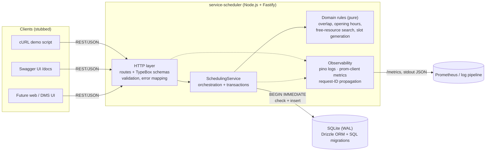
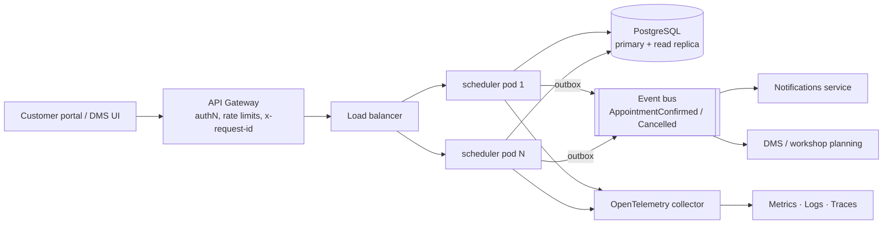

# Unified Service Scheduler: System Design

**Scenario A (Ownership domain).** This service replaces manual booking. It lets a customer, or staff acting for one, book a service appointment for a vehicle at a dealership. The booking is confirmed only when a **qualified technician** and a **service bay** are both free for the **entire** service duration.

**Implementation scope:** backend, built in full (REST API + persistent database). The client is stubbed through an OpenAPI contract, Swagger UI and a cURL demo script.

---

## 1. Requirements and assumptions

### Core requirements → where they are met

| Requirement | Implementation |
|---|---|
| 1. Resource-constrained booking (vehicle, service type, dealership, desired time) | `POST /v1/appointments` |
| 2. Real-time availability: a bay **and** a qualified technician for the whole duration | `SchedulingService.book()` checks overlaps inside a write-locked transaction; `GET /v1/dealerships/{id}/availability` lists open slots |
| 3. Persistent appointment linking customer, vehicle, technician and bay | `appointments` table (SQLite via Drizzle ORM) |

### Assumptions (the brief leaves these open)

| # | Assumption | Rationale |
|---|---|---|
| A1 | **The system assigns** the technician and bay. The client only chooses dealership, service type, vehicle and time. | Matches "check availability of a bay and a qualified technician". Customers rarely choose a specific bay. A `preferredTechnicianId` could be added later. Unknown fields are rejected (400), not silently ignored. |
| A2 | Each **service type has a fixed duration**, and a **technician is qualified per service type** (many-to-many). | Simplest model that makes "qualified" meaningful. |
| A3 | **Every bay can host every service.** | Bay capabilities (lift, alignment rig, EV isolation bay) would mirror technician qualifications; listed as future work. |
| A4 | Each dealership has one daily opening window in its **own IANA timezone**. An appointment must start and finish inside it. Every day is a working day. | Real groups span timezones (the seed data includes London and Sydney). Per-weekday hours, holidays and technician shifts or leave are future work. |
| A5 | Times are exchanged as ISO 8601 with an offset and stored as **UTC epoch ms**. Intervals are half-open `[start, end)`, so back-to-back bookings are allowed. | Makes overlap detection unambiguous and testable. |
| A6 | No buffer time between jobs, and a job is never split across technicians or days. | Keeps the prototype simple. A buffer would be a per-service-type setting. |
| A7 | A **vehicle cannot have two overlapping appointments** (at any dealership). | Prevents a car being physically in two places. |
| A8 | Allocation policy is **first-fit in stable ID order**. | Deterministic and easy to test. Load balancing (least-booked technician) is a pluggable improvement. |
| A9 | Customers, vehicles, technicians and bays are **reference data owned by other systems** (CRM/DMS) and are seeded here. | The brief is about booking, not master-data management. |
| A10 | **Authentication and authorisation are out of scope.** The API assumes it sits behind a gateway that authenticates the caller. | Called out explicitly in §9. |
| A11 | Cancellation is in scope (it releases resources). Rescheduling is cancel-then-book. | Needed to show resources being freed. |

---

## 2. Architecture

### 2.1 As implemented (prototype)



### 2.2 Production target



The service is stateless, so it scales horizontally. Concurrency correctness moves from SQLite's single-writer lock to PostgreSQL constraints (§5.2).

### 2.3 Components

| Component | Responsibility |
|---|---|
| **HTTP layer** (`src/routes`, `src/app.ts`) | Declares routes with TypeBox schemas. These one-source-of-truth schemas drive request validation, response serialisation **and** the OpenAPI document. Maps `AppError` to a consistent error envelope `{ error: { code, message, details, requestId } }`. Versioned under `/v1`. |
| **SchedulingService** (`src/services`) | Use-case orchestration: loads entities, enforces business rules, runs the availability check + insert atomically, handles idempotent retries and cancellation. |
| **Domain rules** (`src/domain`) | Pure functions with no I/O: `overlaps`, `isWithinOperatingHours`, `findFreeResources`, `isVehicleBusy`, `computeAvailableSlots`, timezone conversion. This is where most of the unit tests aim. |
| **Persistence** (`src/db`) | Drizzle schema, versioned SQL migrations (`drizzle/`) applied at start-up, seed data. |
| **Observability** (`src/observability`, Fastify hooks) | Structured JSON logs with a per-request correlation ID, Prometheus metrics, liveness and readiness probes. |

### 2.4 Data model

```mermaid
erDiagram
  DEALERSHIP ||--o{ SERVICE_BAY : has
  DEALERSHIP ||--o{ TECHNICIAN : employs
  TECHNICIAN }o--o{ SERVICE_TYPE : "qualified for (technician_qualifications)"
  CUSTOMER ||--o{ VEHICLE : owns
  APPOINTMENT }o--|| DEALERSHIP : at
  APPOINTMENT }o--|| CUSTOMER : for
  APPOINTMENT }o--|| VEHICLE : services
  APPOINTMENT }o--|| SERVICE_TYPE : of
  APPOINTMENT }o--|| TECHNICIAN : "assigned"
  APPOINTMENT }o--|| SERVICE_BAY : "assigned"

  DEALERSHIP { text id PK; text timezone; int opens_at_minute; int closes_at_minute }
  SERVICE_TYPE { text id PK; text code UK; int duration_minutes }
  APPOINTMENT { text id PK; int starts_at; int ends_at; text status; text idempotency_key UK; int created_at; int cancelled_at }
```

Indexes on `appointments`: `(technician_id, starts_at)`, `(service_bay_id, starts_at)`, `(dealership_id, starts_at)` and `(vehicle_id, starts_at)` serve the overlap and day-schedule queries. A partial unique index on `idempotency_key` guarantees retries never duplicate a booking.

### 2.5 API surface

| Method & path | Purpose |
|---|---|
| `POST /v1/appointments` | Book. Optional `Idempotency-Key` header. Returns 201 for a new booking and 200 for a replayed retry. |
| `GET /v1/appointments/{id}` | Read one appointment |
| `POST /v1/appointments/{id}/cancel` | Cancel (idempotent) and release resources |
| `GET /v1/dealerships/{id}/availability?serviceTypeId&date` | Bookable start times (15-minute grid) with remaining capacity |
| `GET /v1/dealerships/{id}/appointments?date` | Day schedule |
| `GET /v1/dealerships`, `GET /v1/service-types` | Reference data |
| `GET /health`, `/ready`, `/metrics`, `/docs` | Ops |

Error semantics: **400** malformed request · **404** unknown entity · **409** valid request but a resource conflict (no technician, no bay, vehicle already booked) · **422** violates a business rule (past time, outside hours, vehicle not owned by customer, nobody qualified, idempotency key reused). Clients can treat 409 as "try another time" and 422 as "fix the request". Full contract: [`docs/openapi.json`](openapi.json).

---

## 3. Data flow: booking an appointment

```mermaid
sequenceDiagram
  autonumber
  participant C as Client
  participant R as HTTP layer
  participant S as SchedulingService
  participant DB as SQLite

  C->>R: POST /v1/appointments {dealership, customer, vehicle, serviceType, startTime}<br/>Idempotency-Key: k1
  R->>R: Validate schema (400 on failure), attach request ID
  R->>S: book(input, k1)
  S->>DB: BEGIN IMMEDIATE (acquire write lock; other writers wait)
  S->>DB: SELECT appointment WHERE idempotency_key = k1
  alt key already used
    S-->>R: original appointment (200), or 422 if body differs
  else new request
    S->>DB: load dealership, service type, customer, vehicle (404s)
    S->>S: vehicle owned by customer? start in future? within local opening hours? (422s)
    S->>DB: qualified active technicians + active bays (candidates)
    S->>DB: CONFIRMED appointments overlapping [start, end) at dealership or for vehicle
    S->>S: findFreeResources → first free technician + first free bay (409 if none)
    S->>DB: INSERT appointment (CONFIRMED)
    S->>DB: COMMIT (release lock)
    S-->>R: appointment
  end
  R->>R: metrics: booking_attempts_total{outcome}, duration · log outcome
  R-->>C: 201 Created + appointment JSON (x-request-id header)
```

**Availability query:** loads candidates plus that day's confirmed appointments in two indexed queries, then calls the pure `computeAvailableSlots`. The work is O(slots × appointments-that-day), which is trivial at dealership scale (about 40 slots and tens of jobs). The booking endpoint recomputes everything under the lock, so a slot shown as free can still be lost to a faster customer. That race is handled correctly and returns a clean 409.

---

## 4. Technology choices

| Choice | Why |
|---|---|
| **TypeScript + Node.js** | Strong typing across schema, service and tests. A large ecosystem, and a common stack for API services. |
| **Fastify 5** | High-throughput, low-overhead HTTP framework with first-class JSON-schema validation, structured logging (pino) built in, and `inject()` for fast HTTP tests without opening sockets. |
| **TypeBox** (`@fastify/type-provider-typebox`) | One schema definition gives runtime validation, static TS types and the OpenAPI spec, so they cannot drift apart. |
| **SQLite (better-sqlite3, WAL mode)** | Real, durable, transactional SQL with zero infrastructure, so reviewers can run it with just `npm install`. `BEGIN IMMEDIATE` gives a simple, provable serialisation point for bookings. |
| **Drizzle ORM + drizzle-kit migrations** | Type-safe, SQL-shaped queries (no hidden N+1 magic) and versioned SQL migrations checked into git. The same schema ports to PostgreSQL with a dialect switch. |
| **prom-client** | De-facto Prometheus client. Provides RED metrics and business counters. |
| **@fastify/swagger + swagger-ui** | Live, interactive API contract at `/docs`. Serves as the client stub. |
| **Vitest** | Fast, TS-native test runner. |
| **Intl API for timezones** | Correct DST handling with no extra date library (Temporal isn't available in Node yet). |

---

## 5. Non-functional design

### 5.1 Correctness under concurrency (the key risk)

Two customers requesting the last slot at the same moment must not both succeed. The check-then-insert therefore runs inside **one `BEGIN IMMEDIATE` transaction**. SQLite grants that lock to one writer at a time, across threads *and* processes. A second booking waits (`busy_timeout = 5s`), then re-reads and sees the first booking. Verified by:

- `test/concurrency.test.ts`, which starts **4 separate OS processes** racing for the only EV technician. Exactly one succeeds and three get `NO_TECHNICIAN_AVAILABLE`.
- **Mutation testing of that test.** Switching to a deferred transaction made it fail (`SQLITE_BUSY` errors). Removing the transaction let **all four processes book the same technician**. The test therefore detects the bug it exists to catch.

### 5.2 Scalability path

SQLite has a single writer, which is fine for one node and for a single dealership group's booking volume (each booking transaction takes about 1 ms). To scale out:

1. **Move to PostgreSQL.** The Drizzle schema ports with a dialect switch. Replace the global write lock with **per-resource guarantees**:
   - `EXCLUDE USING gist (technician_id WITH =, tstzrange(starts_at, ends_at) WITH &&) WHERE (status = 'CONFIRMED')`, and the same for `service_bay_id` and `vehicle_id`. The database itself then makes double-booking impossible, even when bookings at different dealerships run in parallel.
   - Allocation retries on an exclusion violation with the next free candidate.
2. **Run stateless replicas** behind a load balancer. Nothing is held in memory between requests.
3. **Serve the availability read path** from a read replica, with short-TTL caching per (dealership, date, service type) that is invalidated by booking events. The write path always re-checks, so a stale cache can only cause a 409, never a double booking.
4. **Partition by dealership** (`dealership_id` is on every hot query) if one database becomes a bottleneck.

### 5.3 Reliability

- **Idempotency-Key** makes client retries after timeouts safe. A partial unique index enforces it, and a mismatched body is rejected.
- **Graceful shutdown** (SIGTERM drains in-flight requests, then closes the DB).
- **Readiness probe** checks the database; **liveness** is independent of it.
- **Migrations run automatically** at start-up, are versioned and are reviewed as SQL.
- **Domain events (future):** an outbox table written in the same transaction publishes `AppointmentConfirmed` / `AppointmentCancelled` to notifications or DMS without dual-write inconsistency.

### 5.4 Maintainability

Layering is HTTP → service → pure domain. The business rules have no I/O and are unit-tested in isolation. Schemas are the single source of truth for validation, types and docs. Errors use stable machine-readable codes.

---

## 6. Observability strategy

| Signal | Implemented | Production extension |
|---|---|---|
| **Logs** | Structured JSON (pino). Every log line carries `reqId`. Booking outcome logs include `appointmentId`, `dealershipId`, `technicianId`, `serviceBayId`, `outcome`. Unexpected errors are logged with a stack; client errors are not logged as errors. | Ship to ELK/Loki, redact PII (customer contact data is never logged today), alert on `level>=50`. |
| **Correlation** | `x-request-id` is accepted from upstream or generated, echoed in the response header, and included in every error body, so a support ticket can be matched to the logs. | Becomes the W3C `traceparent` via OpenTelemetry. |
| **Metrics** (`/metrics`) | `http_request_duration_seconds{method,route,status_code}` (RED), `appointment_booking_attempts_total{outcome}`, `appointment_booking_duration_seconds{outcome}` (includes lock wait), and Node runtime metrics. | Dashboards for booking success rate and conflict rate per dealership. **SLO:** p99 booking latency < 300 ms, 5xx rate < 0.1 %. Alert on a spike in lock-wait latency (contention) or `NO_*_AVAILABLE` (capacity planning signal). |
| **Tracing** | Not implemented. | OpenTelemetry auto-instrumentation for Fastify + DB spans, exported via an OTLP collector. |
| **Health** | `/health` (liveness), `/ready` (DB check). | Kubernetes probes. |

The booking outcome counter is also a **business metric**. A rising `NO_BAY_AVAILABLE` rate at a dealership tells operations it needs more bays, not more technicians.

---

## 7. Security considerations

Out of scope for the prototype, but designed for:

- AuthN/Z at the gateway (OAuth2/OIDC). The service would check that the caller may act for `customerId` (customer portal) or `dealershipId` (staff).
- All input is schema-validated, unknown fields are rejected, and queries are parameterised by Drizzle.
- No PII in logs or metrics labels.

---

## 8. Testing strategy

| Layer | File | What it proves |
|---|---|---|
| Unit (pure) | `test/scheduling.test.ts` | Overlap edge cases (containment, partial, back-to-back), opening-hours boundaries, free-resource filtering, slot generation and capacity counts |
| Unit (pure) | `test/time.test.ts` | Timezone conversion incl. BST/GMT, a DST change and the Sydney date line; calendar-date validation |
| API integration | `test/appointments.api.test.ts` | All three core requirements through HTTP against a real (in-memory) SQLite DB: qualified-technician assignment, bay exhaustion, whole-duration checks, vehicle double-booking, cancellation releasing resources, idempotency, every validation path, availability ↔ booking consistency |
| Concurrency | `test/concurrency.test.ts` | Multi-process race on a shared DB file books exactly once (mutation-tested) |
| Ops | `test/health.test.ts` | Probes, metrics content, request-ID propagation, OpenAPI served |

A fixed clock is injected (`now`), so date-dependent tests are deterministic.

---

## 9. How GenAI was used in the design phase

I used Claude Code as a design partner and made the decisions myself.

1. **Framing the brief.** I gave the AI the full brief and my existing scaffold (Fastify + TypeScript + Vitest). It inspected the repo before proposing anything. That inspection also found a real bug in my `tsconfig.json`: the `include` path pointed at `service-scheduler/src` from inside `service-scheduler`, so typecheck skipped all source files.
2. **Forcing explicit decisions.** Instead of letting the AI pick silently, I had it present the decisions that shape the architecture as options with trade-offs, and I chose:
   - Database: **SQLite + Drizzle** (zero setup for reviewers, Postgres as the documented production target) over Postgres + Prisma.
   - Concurrency: **transaction + overlap check** over fixed slot-locking (supports arbitrary durations).
   - Extras: OpenAPI/Swagger, seed + cURL demo, metrics, availability query endpoint.
3. **Surfacing ambiguity.** I asked the AI to list everything the brief leaves open. Those became assumptions A1–A11 above. I reviewed each one, for example insisting on dealership-local timezones rather than "assume UTC", and rejecting unknown request fields rather than silently stripping them.
4. **Challenging the design.** The AI's first concurrency test ran concurrent requests in one process. On review it pointed out that better-sqlite3 is synchronous, so that test could never fail and proved nothing. The design was changed to include a **multi-process race test**, plus **mutation testing of that test** to show it catches the bug.
5. **Diagrams and documentation.** The AI drafted the Mermaid diagrams and this document. I edited them for accuracy against the actual code.

---

## 10. Future work

Technician shifts, leave and breaks · bay capabilities · per-weekday hours and holidays · `preferredTechnicianId` and load-balanced allocation · reschedule endpoint · outbox + domain events · Postgres exclusion constraints · OpenTelemetry tracing · auth · pagination on schedule listings · a frontend booking flow on top of `/availability`.
