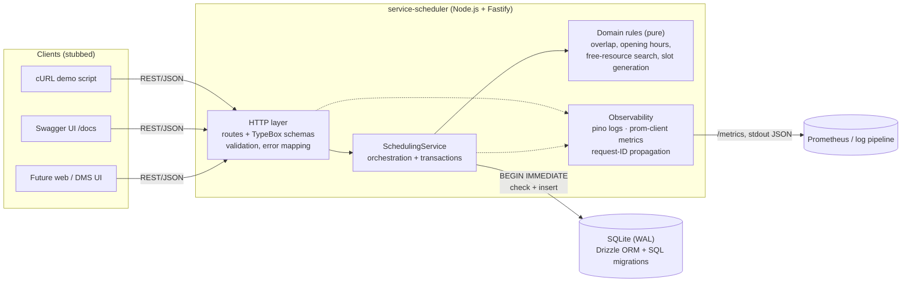
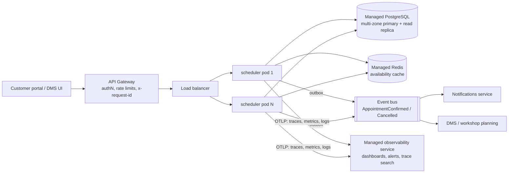
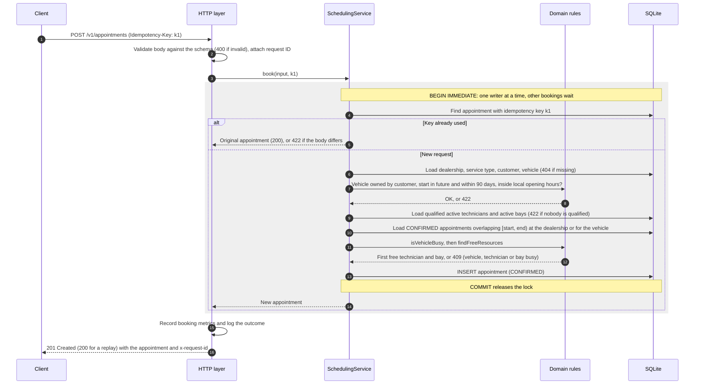
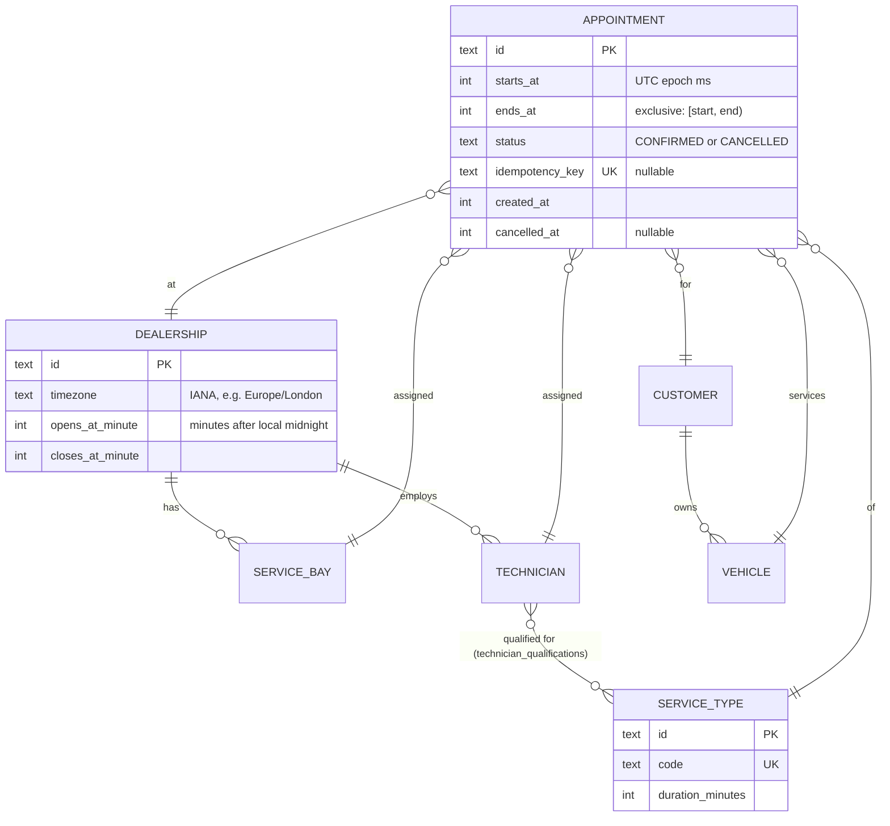

# Unified Service Scheduler: System Design

**Scenario A (Ownership domain).** This service replaces manual booking. It lets a dealership **service advisor** book a service appointment for a customer's vehicle at a dealership. The booking is confirmed only when a **qualified technician** and a **service bay** are both free for the **entire** service duration.

**Implementation scope:** backend, built in full (REST API + persistent database). The client is stubbed through an OpenAPI contract, Swagger UI and a cURL demo script.

**Why SQLite, not PostgreSQL, for now (D12):** it is the same relational SQL model, and while many requirements are still assumptions, a zero-setup database lets the design change quickly. The schema and queries are portable through Drizzle, and PostgreSQL is the production target (§2.2).

| Document | Contents |
|---|---|
| **This file** | Requirements (functional and non-functional) and the architecture plan: diagram, components, data flow, technologies, observability, GenAI in the design phase |
| [DECISIONS.md](DECISIONS.md) | Product decisions D1–D12 and assumptions A1–A11 |
| [BUILD_FOR_THE_FUTURE.md](BUILD_FOR_THE_FUTURE.md) | Scalability, performance, reliability, maintainability and observability: what is built today and how it grows. Also upgrade triggers, security and privacy, testing |
| [openapi.json](openapi.json) | Full API contract |

---

## 1. Requirements

### 1.1 Functional requirements

| Requirement | Implementation |
|---|---|
| 1. Resource-constrained booking (vehicle, service type, dealership, desired time) | `POST /v1/appointments` |
| 2. Real-time availability: a bay **and** a qualified technician for the whole duration | `SchedulingService.book()` checks overlaps inside a write-locked transaction; `GET /v1/dealerships/{id}/availability` lists open slots |
| 3. Persistent appointment linking customer, vehicle, technician and bay | `appointments` table (SQLite via Drizzle ORM) |

Everything the brief leaves open is settled in [DECISIONS.md](DECISIONS.md).

### 1.2 Non-functional requirements

The brief states no non-functional requirements. Sizing comes from D4 (a dealer group of about 50 dealerships, 5,000 bookings a day, a peak of about 10 booking requests per second), and the main targets were confirmed in D10. Rows marked **assumed** are reasonable defaults not yet confirmed. How each one is met and verified: [Build for the future](BUILD_FOR_THE_FUTURE.md#at-a-glance).

| Quality | Requirement | Basis |
|---|---|---|
| **Consistency** | Zero double-bookings of a technician, bay or vehicle. Correctness comes before speed. | Core requirement 2, D10 |
| **Availability** | 99.9% per year (≤ 8.8 h downtime) | D10: booking must be up whenever dealerships are open |
| **Performance** | Booking p95 < 1 s, p99 < 2 s. Availability query p95 < 1 s. | D10: an advisor can wait a moment for a correct schedule. The budget leaves room for a separately deployed database (network round trips) and future pricing (e.g. holiday surcharges). |
| **Throughput** | 10 bookings/s sustained at peak, with bursts of 5× (50/s) handled without errors | D4 sizing; bursts per D10 (e.g. a manufacturer recall campaign) |
| **Security / privacy** | Compliant with UK and EU GDPR ([Build for the future §7](BUILD_FOR_THE_FUTURE.md#7-security-and-privacy)) | D10 |
| **Observability** | Any failed booking can be traced end to end from its request or trace ID; alerts fire before an SLO is breached. Telemetry goes to a managed cloud service. | D11 |
| **Durability / recovery** | RPO 24 h, RTO 4 h | D5 |
| **Data growth** | Latency stays flat with indefinite retention (about 1.8M appointments a year for the group) | D6 |
| **Retry safety** | A retried request never creates a second booking | Assumed: clients retry after timeouts and dropped connections |
| **Compatibility** | No breaking change within `/v1`; breaking changes ship as `/v2` alongside it | D9 |
| **Maintainability** | A business-rule change touches one layer and one test file | Assumed |
| **Deployability** | Runs with one command and no external infrastructure | Assumed: reviewers must be able to run it, and D4 fits a single node |

---

## 2. Architecture

### 2.1 As implemented (prototype)

### 2.2 Production target

The service is stateless, so it scales horizontally. The database is deployed separately as a managed, multi-zone service for scaling and availability. Concurrency correctness then moves from SQLite's single-writer lock to PostgreSQL constraints ([Build for the future §1](BUILD_FOR_THE_FUTURE.md#1-scalability)). Telemetry goes to a managed cloud service instead of a self-run monitoring stack (§6).

---

## 3. Components

| Component | Responsibility |
|---|---|
| **HTTP layer** (`src/routes/v1`, `src/app.ts`) | Declares routes with TypeBox schemas. These one-source-of-truth schemas drive request validation, response serialisation **and** the OpenAPI document. Maps `AppError` to a consistent error envelope `{ error: { code, message, details, requestId } }`. Versioned under `/v1` (D9). |
| **SchedulingService** (`src/services`) | Use-case orchestration: loads entities, enforces business rules, runs the availability check + insert atomically, handles idempotent retries and cancellation. |
| **Domain rules** (`src/domain`) | Pure functions with no I/O: `overlaps`, `isWithinOperatingHours`, `findFreeResources`, `isVehicleBusy`, `computeAvailableSlots`, timezone conversion. This is where most of the unit tests aim. |
| **Persistence** (`src/db`) | Drizzle schema, versioned SQL migrations (`drizzle/`) applied at start-up, seed data. |
| **Observability** (`src/observability`, Fastify hooks) | Structured JSON logs with a per-request correlation ID, Prometheus metrics, liveness and readiness probes. |

---

## 4. Data flow: booking an appointment

Every check that decides the booking runs inside the shaded transaction, so two requests for the last slot can't both succeed. Any error rolls the transaction back and nothing is written.

**Availability query:** loads candidates plus that day's confirmed appointments in two indexed queries, then calls the pure `computeAvailableSlots`. The work is O(slots × appointments-that-day), which is trivial at dealership scale (about 40 slots and tens of jobs). The booking endpoint recomputes everything under the lock, so a slot shown as free can still be lost to a faster customer. That race is handled correctly and returns a clean 409.

---

## 5. Chosen technologies and justifications

| Choice | Why |
|---|---|
| **TypeScript + Node.js** | Strong typing across schema, service and tests. A large ecosystem, and a common stack for API services. |
| **Fastify 5** | High-throughput, low-overhead HTTP framework with first-class JSON-schema validation, structured logging (pino) built in, and `inject()` for fast HTTP tests without opening sockets. |
| **TypeBox** (`@fastify/type-provider-typebox`) | One schema definition gives runtime validation, static TS types and the OpenAPI spec, so they cannot drift apart. |
| **SQLite (better-sqlite3, WAL mode)** | Chosen over PostgreSQL for the prototype (D12): the same SQL model, quick to change while requirements settle, and a dialect switch away from PostgreSQL in production. Real, durable, transactional SQL with zero infrastructure, so reviewers can run it with just `npm install`. `BEGIN IMMEDIATE` gives a simple, provable serialisation point for bookings. |
| **Drizzle ORM + drizzle-kit migrations** | Type-safe, SQL-shaped queries (no hidden N+1 magic) and versioned SQL migrations checked into git. The same schema ports to PostgreSQL with a dialect switch. |
| **prom-client** | De-facto Prometheus client. Provides RED metrics and business counters. |
| **@fastify/swagger + swagger-ui** | Live, interactive API contract at `/docs`. Serves as the client stub. |
| **Vitest** | Fast, TS-native test runner. |
| **Docker (multi-stage) + Compose** | One-command start for reviewers. The runtime image holds only compiled JS and production dependencies, runs as a non-root user, has a `/ready` healthcheck, and keeps SQLite on a named volume. The same image is the deployable unit for the production target (§2.2). |
| **Managed PostgreSQL** (planned, production, D12) | Row-level concurrency and exclusion constraints that make double-booking impossible at the database level, with no global lock; managed multi-zone failover and point-in-time recovery for the availability and recovery targets. The Drizzle schema moves over with a dialect switch. |
| **Managed Redis** (planned, when a trigger fires) | A cache shared by all replicas for availability results, cleared on every booking or cancellation, so one booking updates every instance's view ([Build for the future §2](BUILD_FOR_THE_FUTURE.md#2-performance)). |
| **Intl API for timezones** | Correct DST handling with no extra date library (Temporal isn't available in Node yet). |
| **OpenTelemetry + a managed observability service** (D11; SDK built, vendor simulated) | The vendor-neutral standard for traces, metrics and logs. The code only emits telemetry over OTLP; storage, dashboards and alerting are bought, not built, and the vendor can change without code changes. |

---

## 6. Observability strategy

**Strategy: emit standard telemetry from the code, and use a managed cloud service for everything else** (D11). Storing logs, metrics and traces, dashboards, alerting and on-call are bought, not built. Running our own Prometheus, log stack or Jaeger would add scope without adding value to a booking service. The code speaks only open standards (OpenTelemetry/OTLP, Prometheus format, JSON logs on stdout), so the vendor (e.g. Grafana Cloud, AWS CloudWatch with X-Ray, Azure Monitor, Datadog) is a deployment choice. It must store data in the right region under a data-processing agreement (GDPR, [Quality §7](BUILD_FOR_THE_FUTURE.md#7-security-and-privacy)).

| Signal | In the code | Managed service does |
|---|---|---|
| **Logs** | **Built.** Structured JSON (pino) on stdout. Every line carries `reqId`. Booking outcome logs include `appointmentId`, `dealershipId`, `technicianId`, `serviceBayId`, `outcome`. Unexpected errors are logged with a stack; client errors are not logged as errors. No names or contact details, only IDs. When tracing is on, every line also carries `trace_id`. | Collects stdout through the platform's log agent; search; 30-day retention; alert on error-level logs. |
| **Metrics** | **Built.** `/metrics` in Prometheus format: `http_request_duration_seconds{method,route,status_code}` (RED), `appointment_booking_attempts_total{outcome}`, `appointment_booking_duration_seconds{outcome}` (includes lock wait), Node runtime metrics. | Managed Prometheus scrapes `/metrics`. Dashboards for booking success and conflict rates per dealership. |
| **Traces** | **Built, off by default.** The OpenTelemetry Node SDK (`src/observability/tracing.ts`) loads before the app and instruments HTTP. An `appointment.book` span wraps each booking with its outcome and the dealership, service type, appointment, technician and bay IDs; customer and vehicle IDs are never put on spans (`test/tracing.test.ts`). Configured only through the standard `OTEL_*` environment variables: `npm run start:otel-demo` prints spans to the console as a local simulation, and a managed service is reached by setting the standard OTLP endpoint and API-key variables. On PostgreSQL, the driver's instrumentation will add a span per query. | Stores traces and links them to logs through `trace_id`. |
| **Correlation** | **Built.** `x-request-id` is accepted from upstream or generated, echoed in the response header and included in every error body, so a support ticket can be matched to the logs. When tracing is on, the W3C `traceparent` from the gateway is honoured, so the booking span joins the caller's trace. | End-to-end view from the gateway through the service to the database. |
| **Health** | **Built.** `/health` (liveness) and `/ready` (database check). | The platform's probes restart or stop routing to an unhealthy instance. |
| **Alerting** | Nothing in the code. | **SLO alerts (§1.2):** booking p95 > 1 s, 5xx rate > 0.1%, availability error-budget burn. Also alert on a spike in lock-wait latency (contention) or in `NO_*_AVAILABLE` (capacity planning signal). |

The booking outcome counter is also a **business metric**. A rising `NO_BAY_AVAILABLE` rate at a dealership tells operations it needs more bays, not more technicians.

---

## 7. How GenAI was used in the design phase

I used Claude Code as a design partner. It drafted options, documents and diagrams; I made the product decisions. Full process: the README's AI Collaboration Narrative.

1. **Framing the brief.** I gave the AI the full brief and my existing scaffold (Fastify + TypeScript + Vitest). It inspected the repo before proposing anything, and found a real bug in my `tsconfig.json`: the `include` path pointed at `service-scheduler/src` from inside `service-scheduler`, so typecheck skipped all source files.
2. **Forcing explicit decisions.** I had the AI present the architecture-shaping choices as options with trade-offs, and I chose:
   - Database: **SQLite + Drizzle** (zero setup for reviewers, PostgreSQL as the documented production target) over PostgreSQL + Prisma.
   - Concurrency: **transaction + overlap check** over fixed slot locking (supports any duration).
   - Extras: OpenAPI/Swagger, seed + cURL demo, metrics, availability endpoint.
3. **Assumptions, then decisions.** The AI wrote down everything the brief leaves open as assumptions A1–A11, including its own choices of dealership-local timezones and rejecting unknown request fields. I then asked it to put the open questions to me rather than assume. Two rounds of structured questions produced decisions D1–D8 ([DECISIONS.md](DECISIONS.md)). For recovery, retention and deployment I picked the simpler option, and asked for the recommended production design to be recorded with upgrade triggers ([Build for the future §6](BUILD_FOR_THE_FUTURE.md#6-upgrade-triggers)).
4. **Challenging the design with evidence.**
   - The AI's first concurrency test could never fail (better-sqlite3 is synchronous), so the design gained a **multi-process race test**, mutation-tested to prove it catches double-booking.
   - Before committing to performance targets, the AI **benchmarked** instead of trusting its earlier "about 1 ms" claim. That exposed a history-proportional query scan (53 ms at 500k rows), which was fixed and is now guarded ([Build for the future §2](BUILD_FOR_THE_FUTURE.md#2-performance)).
5. **Diagrams and documentation.** The AI drafted the Mermaid diagrams and this document. In a final pass it rechecked them against the code, and corrected claims that had drifted or were never true.

---

## 8. Data model and API surface

### 8.1 Data model

Indexes on `appointments`: `(technician_id, starts_at)`, `(service_bay_id, starts_at)`, `(dealership_id, starts_at)` and `(vehicle_id, starts_at)` serve the overlap and day-schedule queries. A partial unique index on `idempotency_key` guarantees retries never duplicate a booking.

### 8.2 API surface

| Method & path | Purpose |
|---|---|
| `POST /v1/appointments` | Book. Optional `Idempotency-Key` header. Returns 201 for a new booking and 200 for a replayed retry. |
| `GET /v1/appointments/{id}` | Read one appointment |
| `POST /v1/appointments/{id}/cancel` | Cancel (idempotent) and release resources |
| `GET /v1/dealerships/{id}/availability?serviceTypeId&date` | Bookable start times (15-minute grid) with remaining capacity |
| `GET /v1/dealerships/{id}/appointments?date` | Day schedule |
| `GET /v1/dealerships`, `GET /v1/service-types` | Reference data |
| `GET /health`, `/ready`, `/metrics`, `/docs` | Ops |

Errors share one envelope: `{"error": {"code", "message", "details?", "requestId"}}`.

| Status | Meaning | Codes |
|---|---|---|
| **400** | Malformed request | `VALIDATION_ERROR` |
| **404** | Unknown entity | `NOT_FOUND` |
| **409** | Valid request, but a conflict. Client: "try another time". | `NO_TECHNICIAN_AVAILABLE`, `NO_BAY_AVAILABLE`, `VEHICLE_ALREADY_BOOKED`, `APPOINTMENT_NOT_CANCELLABLE` |
| **422** | Breaks a business rule. Client: "fix the request". | `START_TIME_IN_PAST`, `BEYOND_BOOKING_HORIZON`, `OUTSIDE_OPERATING_HOURS`, `VEHICLE_NOT_OWNED_BY_CUSTOMER`, `NO_QUALIFIED_TECHNICIAN`, `IDEMPOTENCY_KEY_REUSED` |

Full contract: [`docs/openapi.json`](openapi.json), or Swagger UI at `/docs`.

---

## 9. Future work

**Planned upgrades with defined triggers:** continuous backup (RPO ≤ 1 min), 7-year retention with anonymisation, and regional deployments. See [Build for the future §6](BUILD_FOR_THE_FUTURE.md#6-upgrade-triggers).

**Feature backlog:** technician shifts, leave and breaks · bay capabilities · per-weekday hours and holidays · `preferredTechnicianId` and load-balanced allocation · atomic reschedule endpoint (keep the original if the new slot is taken) · nearest free slots returned with a `409` · outbox + domain events, then notifications (confirmation, reminder, cancellation) · Postgres exclusion constraints · availability cache in Redis (Build for the future §2) · auth · pagination on schedule listings · a frontend booking flow on top of `/availability`, with short-lived booking holds (expired lazily at query time) so a slot isn't taken while the form is being filled in.
