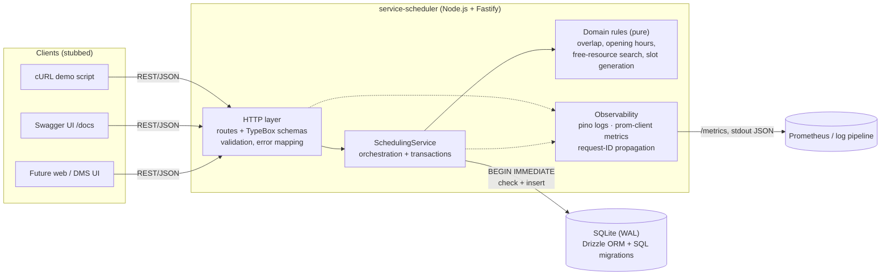
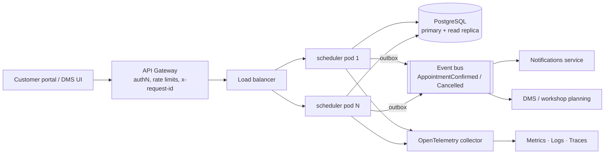

# Unified Service Scheduler: System Design

**Scenario A (Ownership domain).** This service replaces manual booking. It lets a dealership **service advisor** book a service appointment for a customer's vehicle at a dealership. The booking is confirmed only when a **qualified technician** and a **service bay** are both free for the **entire** service duration.

**Implementation scope:** backend, built in full (REST API + persistent database). The client is stubbed through an OpenAPI contract, Swagger UI and a cURL demo script.

---

## 1. Requirements and assumptions

### Core requirements → where they are met

| Requirement | Implementation |
|---|---|
| 1. Resource-constrained booking (vehicle, service type, dealership, desired time) | `POST /v1/appointments` |
| 2. Real-time availability: a bay **and** a qualified technician for the whole duration | `SchedulingService.book()` checks overlaps inside a write-locked transaction; `GET /v1/dealerships/{id}/availability` lists open slots |
| 3. Persistent appointment linking customer, vehicle, technician and bay | `appointments` table (SQLite via Drizzle ORM) |

### Decisions confirmed with the product owner

The brief leaves these open. I put them to the product owner (myself, acting in that role for this assessment) as explicit options with trade-offs. Recorded 2026-10-29.

| # | Decision | Chosen over | Consequence |
|---|---|---|---|
| D1 | The booker is a **service advisor** (dealership staff). Customers and vehicles already exist in the DMS. | Customer self-service; both | No customer sign-up or "my vehicles" flow. Unknown customer or vehicle → 404. Authorisation is by dealership (§7). |
| D2 | The **system auto-assigns** the technician and bay (see A1). | Optional preferred technician; caller picks both | Simple, deterministic API. A caller-supplied `technicianId` is rejected (400) rather than silently ignored. |
| D3 | Technicians work **whenever the dealership is open**. No shifts, breaks or leave (see A4). | Per-technician shifts | Availability can overstate capacity on days a technician is absent. Listed as future work (§10). |
| D4 | Scale targets are those of a **dealer group** (§5.0). | National platform; unstated | A single SQLite node is acceptable. PostgreSQL is the documented growth path (§5.2). |
| D5 | Recovery: **RPO 24 h, RTO 4 h**, from nightly backups. | RPO ≤ 1 min (continuous replication) | Simpler operations, but **up to a day of confirmed bookings can be lost** in a disaster. Recommended production target and trigger: §5.5. |
| D6 | Appointment records are **kept indefinitely** as service history. | Anonymise after ~7 years; out of scope | History grows without bound. That drives the query fix in §5.0, and needs a documented GDPR legitimate-interest basis (§7). Recommended: 7 years, then anonymise (§5.5). |
| D7 | Appointments can be booked at most **90 days ahead**. | No limit; configurable per dealership | Bounds future-dated data. Implemented as 422 `BEYOND_BOOKING_HORIZON`; the availability endpoint offers no slots past the horizon. The limit is a service option, so per-dealership configuration is a small change. |
| D8 | **Single global deployment** serving all regions (UK, Australia). | Regional deployments | Simplest to run, but **UK/EU and Australian customer data share one database**, which may conflict with data-residency rules (§7). Recommended: regional deployments, with triggers in §5.5. |
| D9 | **API versioning:** the URL carries the major version (`/v1`) and the code mirrors it (`src/routes/v1/`). Releases follow semver, with `package.json` as the single source (served as OpenAPI `info.version`), a git tag `vX.Y.Z` and `CHANGELOG.md`. | Header or media-type versioning; unversioned routes | Additive changes stay in `/v1`. A breaking change adds `src/routes/v2/`, reusing the same services and domain, and runs alongside `/v1` until it is retired. Global schema `$id`s (`Appointment`, `ErrorResponse`) are shared, so a v2 shape needs its own `$id`. |

### Assumptions (the brief leaves these open)

| # | Assumption | Rationale |
|---|---|---|
| A1 | **The system assigns** the technician and bay. The client only chooses dealership, service type, vehicle and time. **Confirmed (D2).** | Matches "check availability of a bay and a qualified technician". Customers rarely choose a specific bay. A `preferredTechnicianId` could be added later. Unknown fields are rejected (400), not silently ignored. |
| A2 | Each **service type has a fixed duration**, and a **technician is qualified per service type** (many-to-many). | Simplest model that makes "qualified" meaningful. |
| A3 | **Every bay can host every service.** | Bay capabilities (lift, alignment rig, EV isolation bay) would mirror technician qualifications; listed as future work. |
| A4 | Each dealership has one daily opening window in its **own IANA timezone**. An appointment must start and finish inside it. Every day is a working day, and every active technician works all opening hours. **Confirmed (D3).** | Real groups span timezones (the seed data includes London and Sydney). Per-weekday hours, holidays and technician shifts or leave are future work. |
| A5 | Times are exchanged as ISO 8601 with an offset and stored as **UTC epoch ms**. Intervals are half-open `[start, end)`, so back-to-back bookings are allowed. | Makes overlap detection unambiguous and testable. |
| A6 | No buffer time between jobs, and a job is never split across technicians or days. | Keeps the prototype simple. A buffer would be a per-service-type setting. |
| A7 | A **vehicle cannot have two overlapping appointments** (at any dealership). | Prevents a car being physically in two places. |
| A8 | Allocation policy is **first-fit in stable ID order**. | Deterministic and easy to test. Load balancing (least-booked technician) is a pluggable improvement. |
| A9 | Customers, vehicles, technicians and bays are **reference data owned by other systems** (CRM/DMS) and are seeded here. | The brief is about booking, not master-data management. |
| A10 | **Authentication and authorisation are out of scope.** The API assumes it sits behind a gateway that authenticates the caller. | Called out explicitly in §9. |
| A11 | Cancellation is in scope (it releases resources). Rescheduling is cancel-then-book. | Needed to show resources being freed. |

---

## 2. Architecture

### 2.1 As implemented (prototype)



### 2.2 Production target



The service is stateless, so it scales horizontally. Concurrency correctness moves from SQLite's single-writer lock to PostgreSQL constraints (§5.2).

### 2.3 Components

| Component | Responsibility |
|---|---|
| **HTTP layer** (`src/routes`, `src/app.ts`) | Declares routes with TypeBox schemas. These one-source-of-truth schemas drive request validation, response serialisation **and** the OpenAPI document. Maps `AppError` to a consistent error envelope `{ error: { code, message, details, requestId } }`. Versioned under `/v1`. |
| **SchedulingService** (`src/services`) | Use-case orchestration: loads entities, enforces business rules, runs the availability check + insert atomically, handles idempotent retries and cancellation. |
| **Domain rules** (`src/domain`) | Pure functions with no I/O: `overlaps`, `isWithinOperatingHours`, `findFreeResources`, `isVehicleBusy`, `computeAvailableSlots`, timezone conversion. This is where most of the unit tests aim. |
| **Persistence** (`src/db`) | Drizzle schema, versioned SQL migrations (`drizzle/`) applied at start-up, seed data. |
| **Observability** (`src/observability`, Fastify hooks) | Structured JSON logs with a per-request correlation ID, Prometheus metrics, liveness and readiness probes. |

### 2.4 Data model

```mermaid
erDiagram
  DEALERSHIP ||--o{ SERVICE_BAY : has
  DEALERSHIP ||--o{ TECHNICIAN : employs
  TECHNICIAN }o--o{ SERVICE_TYPE : "qualified for (technician_qualifications)"
  CUSTOMER ||--o{ VEHICLE : owns
  APPOINTMENT }o--|| DEALERSHIP : at
  APPOINTMENT }o--|| CUSTOMER : for
  APPOINTMENT }o--|| VEHICLE : services
  APPOINTMENT }o--|| SERVICE_TYPE : of
  APPOINTMENT }o--|| TECHNICIAN : "assigned"
  APPOINTMENT }o--|| SERVICE_BAY : "assigned"

  DEALERSHIP { text id PK; text timezone; int opens_at_minute; int closes_at_minute }
  SERVICE_TYPE { text id PK; text code UK; int duration_minutes }
  APPOINTMENT { text id PK; int starts_at; int ends_at; text status; text idempotency_key UK; int created_at; int cancelled_at }
```

Indexes on `appointments`: `(technician_id, starts_at)`, `(service_bay_id, starts_at)`, `(dealership_id, starts_at)` and `(vehicle_id, starts_at)` serve the overlap and day-schedule queries. A partial unique index on `idempotency_key` guarantees retries never duplicate a booking.

### 2.5 API surface

| Method & path | Purpose |
|---|---|
| `POST /v1/appointments` | Book. Optional `Idempotency-Key` header. Returns 201 for a new booking and 200 for a replayed retry. |
| `GET /v1/appointments/{id}` | Read one appointment |
| `POST /v1/appointments/{id}/cancel` | Cancel (idempotent) and release resources |
| `GET /v1/dealerships/{id}/availability?serviceTypeId&date` | Bookable start times (15-minute grid) with remaining capacity |
| `GET /v1/dealerships/{id}/appointments?date` | Day schedule |
| `GET /v1/dealerships`, `GET /v1/service-types` | Reference data |
| `GET /health`, `/ready`, `/metrics`, `/docs` | Ops |

Error semantics: **400** malformed request · **404** unknown entity · **409** valid request but a conflict (no technician, no bay, vehicle already booked, appointment already started when cancelling) · **422** violates a business rule (past time, beyond the 90-day horizon, outside hours, vehicle not owned by customer, nobody qualified, idempotency key reused). Clients can treat 409 as "try another time" and 422 as "fix the request". Full contract: [`docs/openapi.json`](openapi.json).

---

## 3. Data flow: booking an appointment

```mermaid
sequenceDiagram
  autonumber
  participant C as Client
  participant R as HTTP layer
  participant S as SchedulingService
  participant DB as SQLite

  C->>R: POST /v1/appointments {dealership, customer, vehicle, serviceType, startTime}<br/>Idempotency-Key: k1
  R->>R: Validate schema (400 on failure), attach request ID
  R->>S: book(input, k1)
  S->>DB: BEGIN IMMEDIATE (acquire write lock; other writers wait)
  S->>DB: SELECT appointment WHERE idempotency_key = k1
  alt key already used
    S-->>R: original appointment (200), or 422 if body differs
  else new request
    S->>DB: load dealership, service type, customer, vehicle (404s)
    S->>S: vehicle owned by customer? start in future? within local opening hours? (422s)
    S->>DB: qualified active technicians + active bays (candidates)
    S->>DB: CONFIRMED appointments overlapping [start, end) at dealership or for vehicle
    S->>S: findFreeResources → first free technician + first free bay (409 if none)
    S->>DB: INSERT appointment (CONFIRMED)
    S->>DB: COMMIT (release lock)
    S-->>R: appointment
  end
  R->>R: metrics: booking_attempts_total{outcome}, duration · log outcome
  R-->>C: 201 Created + appointment JSON (x-request-id header)
```

**Availability query:** loads candidates plus that day's confirmed appointments in two indexed queries, then calls the pure `computeAvailableSlots`. The work is O(slots × appointments-that-day), which is trivial at dealership scale (about 40 slots and tens of jobs). The booking endpoint recomputes everything under the lock, so a slot shown as free can still be lost to a faster customer. That race is handled correctly and returns a clean 409.

---

## 4. Technology choices

| Choice | Why |
|---|---|
| **TypeScript + Node.js** | Strong typing across schema, service and tests. A large ecosystem, and a common stack for API services. |
| **Fastify 5** | High-throughput, low-overhead HTTP framework with first-class JSON-schema validation, structured logging (pino) built in, and `inject()` for fast HTTP tests without opening sockets. |
| **TypeBox** (`@fastify/type-provider-typebox`) | One schema definition gives runtime validation, static TS types and the OpenAPI spec, so they cannot drift apart. |
| **SQLite (better-sqlite3, WAL mode)** | Real, durable, transactional SQL with zero infrastructure, so reviewers can run it with just `npm install`. `BEGIN IMMEDIATE` gives a simple, provable serialisation point for bookings. |
| **Drizzle ORM + drizzle-kit migrations** | Type-safe, SQL-shaped queries (no hidden N+1 magic) and versioned SQL migrations checked into git. The same schema ports to PostgreSQL with a dialect switch. |
| **prom-client** | De-facto Prometheus client. Provides RED metrics and business counters. |
| **@fastify/swagger + swagger-ui** | Live, interactive API contract at `/docs`. Serves as the client stub. |
| **Vitest** | Fast, TS-native test runner. |
| **Docker (multi-stage) + Compose** | One-command start for reviewers. The runtime image holds only compiled JS and production dependencies, runs as a non-root user, has a `/ready` healthcheck, and keeps SQLite on a named volume. The same image is the deployable unit for the production target (§2.2). |
| **Intl API for timezones** | Correct DST handling with no extra date library (Temporal isn't available in Node yet). |

---

## 5. Non-functional requirements

### 5.0 Targets and how they are met

Targets come from decision D4: about 50 dealerships and 5,000 bookings a day (about 100 per dealership per day), with a peak of about 10 booking requests per second.

| Quality | Target | How the design meets it | How it is verified | Trade-off / limit |
|---|---|---|---|---|
| **Performance** | Booking p95 < 300 ms. Availability query p95 < 300 ms. | Indexed overlap queries; the whole booking runs in one short local transaction with no network hops to the database. | Benchmark (below). `appointment_booking_duration_seconds` and `http_request_duration_seconds` histograms in production. | Latency is flat with history now that the overlap query is bounded (benchmark below). A query-plan test guards the fix. |
| **Throughput** | 10 bookings/s at peak | SQLite serialises writes. Throughput ≈ 1 / (booking transaction time). | Benchmark: about 0.35 ms per booking (≈ 2,800/s headroom), the same at 0 and 500k history rows. Before the fix, 500k rows took about 53 ms (≈ 19/s). | Single writer. Beyond one node, move to PostgreSQL with per-resource exclusion constraints (§5.2). |
| **Consistency** | Zero double-bookings of a technician, bay or vehicle | Check and insert in one `BEGIN IMMEDIATE` transaction (§5.1) | Multi-process race test, mutation-tested (§5.1) | Bookings at different dealerships also serialise. That's acceptable at this volume, and goes away on PostgreSQL. |
| **Availability** | 99.9% per year (≤ 8.8 h downtime) | Stateless app; fast restart; `/health` and `/ready` probes; graceful shutdown | Probe tests (`test/health.test.ts`); uptime monitoring in production | **Single node.** A host loss restored within the 4 h RTO (D5) uses about half the yearly budget. Fine at this target, not at 99.99%. |
| **Durability / recovery** | RPO 24 h, RTO 4 h (D5) | SQLite file on a persistent volume; nightly backup with `sqlite3 .backup` or a volume snapshot; restore = new node + backup + start (migrations re-apply idempotently) | A restore drill should run at least quarterly (**not yet automated**) | Up to a day of bookings can be lost. Upgrade path: continuous WAL replication (e.g. Litestream) or managed PostgreSQL with point-in-time recovery, giving RPO ≈ seconds. |
| **Scalability (data)** | Indefinite retention (D6): about 1.8M appointment rows a year for the group, about 36k a year per dealership | Hot queries are scoped to one dealership and a time window | Benchmark at 0 / 100k / 500k rows; `test/query-plan.test.ts` | Query latency no longer depends on history, but storage and backup size still grow without bound (§5.5). |
| **Observability** | Diagnose any failed booking from its request ID; alert before SLO breach | Structured logs, correlation ID, RED + business metrics (§6) | `test/health.test.ts` checks metrics and request-ID propagation | No distributed tracing yet (§6). |
| **Security / privacy** | Least privilege; no PII leakage; lawful retention | Gateway authentication, dealership-scoped authorisation, validated input, no PII in logs (§7) | Schema-validation tests (400 on unknown fields) | Authentication isn't implemented in the prototype (A10). Residency risk from D8. |
| **Maintainability** | A business-rule change touches one layer and one test file | Pure domain layer; schema-driven validation, types and OpenAPI (§5.4) | 83 tests; layered test suite (§8) | — |

**Benchmark** (MacBook, Node 25, file-backed SQLite in WAL mode, 2,000 bookings for one dealership, with past appointments preloaded), before and after the fix described below:

| Past appointments at the dealership | Booking p50 (before → after) | Booking p95 (before → after) | Booking p99 (before → after) | Availability query (before → after) |
|---|---|---|---|---|
| 0 | 0.4 → 0.35 ms | 0.5 → 0.56 ms | 0.8 → 1.3 ms | 0.6 → 0.9 ms |
| 100,000 | 10.7 → 0.35 ms | 12.2 → 0.47 ms | 13.0 → 1.4 ms | 11.2 → 0.6 ms |
| 500,000 | 53.3 → 0.37 ms | 59.1 → 0.49 ms | 86.7 → 1.3 ms | 37.0 → 0.7 ms |

Sub-millisecond differences at 0 rows are run-to-run noise.

**Finding (fixed): latency grew linearly with history.** The overlap query filters `starts_at < requested_end` but has no lower bound. SQLite's plan (`SEARCH … USING INDEX appointments_dealership_time_idx (dealership_id=? AND starts_at<?)`) therefore scans every past appointment at the dealership. An appointment must fit inside one business day (A4), so adding `starts_at > requested_start − 24 h` is safe and bounds the scan to about a day of rows, whatever the retention. With retention set to indefinite (D6), this fix is needed for the performance target to hold over time. **Status: applied** (`MAX_APPOINTMENT_MS` in `src/domain/scheduling.ts`). `test/query-plan.test.ts` asserts that SQLite's plan uses a range bounded on both sides; it failed before the fix. Setting the bound to 0 made 9 behavioural tests fail, which confirms a too-tight bound would be caught.

### 5.1 Correctness under concurrency (the key risk)

Two customers requesting the last slot at the same moment must not both succeed. The check-then-insert therefore runs inside **one `BEGIN IMMEDIATE` transaction**. SQLite grants that lock to one writer at a time, across threads *and* processes. A second booking waits (`busy_timeout = 5s`), then re-reads and sees the first booking. Verified by:

- `test/concurrency.test.ts`, which starts **4 separate OS processes** racing for the only EV technician. Exactly one succeeds and three get `NO_TECHNICIAN_AVAILABLE`.
- **Mutation testing of that test.** Switching to a deferred transaction made it fail (`SQLITE_BUSY` errors). Removing the transaction let **all four processes book the same technician**. The test therefore detects the bug it exists to catch.

### 5.2 Scalability path

SQLite has a single writer, which is fine for one node at dealer-group volume. A booking transaction takes about 0.35 ms whatever the history size (§5.0), far above a peak need of 10 bookings per second. To scale out:

1. **Move to PostgreSQL.** The Drizzle schema ports with a dialect switch. Replace the global write lock with **per-resource guarantees**:
   - `EXCLUDE USING gist (technician_id WITH =, tstzrange(starts_at, ends_at) WITH &&) WHERE (status = 'CONFIRMED')`, and the same for `service_bay_id` and `vehicle_id`. The database itself then makes double-booking impossible, even when bookings at different dealerships run in parallel.
   - Allocation retries on an exclusion violation with the next free candidate.
2. **Run stateless replicas** behind a load balancer. Nothing is held in memory between requests.
3. **Serve the availability read path** from a read replica, with short-TTL caching per (dealership, date, service type) that is invalidated by booking events. The write path always re-checks, so a stale cache can only cause a 409, never a double booking.
4. **Partition by dealership** (`dealership_id` is on every hot query) if one database becomes a bottleneck.

### 5.3 Reliability

- **Idempotency-Key** makes client retries after timeouts safe. A partial unique index enforces it, and a mismatched body is rejected.
- **Graceful shutdown** (SIGTERM drains in-flight requests, then closes the DB).
- **Readiness probe** checks the database; **liveness** is independent of it.
- **Migrations run automatically** at start-up, are versioned and are reviewed as SQL.
- **Backups (D5):** a nightly online backup of the SQLite file (`.backup` works while the service runs in WAL mode) to off-host storage, kept for 30 days. RPO 24 h, RTO 4 h. Possible mitigation for the lost-day risk: today's "appointment booked" log line carries the appointment, dealership, technician and bay IDs. Adding the vehicle, customer and start/end times would let lost bookings be rebuilt by hand from shipped logs after a restore. **Not implemented.**
- **Domain events (future):** an outbox table written in the same transaction publishes `AppointmentConfirmed` / `AppointmentCancelled` to notifications or DMS without dual-write inconsistency.

### 5.4 Maintainability

Layering is HTTP → service → pure domain. The business rules have no I/O and are unit-tested in isolation. Schemas are the single source of truth for validation, types and docs. Errors use stable machine-readable codes.

### 5.5 Deliberate simplifications and their upgrade path

For three decisions I chose the simpler option on purpose: D5 (recovery), D6 (retention) and D8 (deployment topology). Each is the right size for a prototype at dealer-group scale. Each also has a known breaking point. The table records what I would recommend for production and the **measurable trigger** for making the change, so the upgrade is planned rather than discovered during an incident.

| Decision | Today (prototype) | Recommended target | Trigger to upgrade | How |
|---|---|---|---|---|
| **D5 Recovery** | Nightly backup. RPO 24 h, RTO 4 h. | **RPO ≤ 1 min, RTO ≤ 1 h** | Before go-live with real customers: a lost confirmed booking means a customer arrives to find no slot. Or as soon as bookings exceed a few hundred a day, the point where a lost day can no longer be rebuilt by hand. | Stream the SQLite WAL continuously to object storage (e.g. Litestream); restore = fetch latest + start. On PostgreSQL: managed point-in-time recovery plus a synchronous standby. Add an automated quarterly restore drill and alert on replication lag. |
| **D6 Retention** | Keep every appointment indefinitely. | **Keep 7 years, then anonymise** personal links. Keep the vehicle's service history. | Before processing real EU/UK personal data (GDPR storage limitation), or when the appointments table makes backup or restore exceed the RTO. | A scheduled job re-points appointments older than 7 years to an anonymised placeholder customer. Move closed history to a reporting store or partitioned archive table, so the operational table holds about a year. The bounded overlap query (§5.0) keeps latency flat in the meantime. |
| **D8 Topology** | One global deployment and database for all regions (UK and Australian seed data). | **One deployment per region** (e.g. EU, APAC). Each dealership's data stays in its region. | Onboarding a market with data-residency rules, cross-region latency approaching the p95 target, or a regional outage needing to be isolated. | `dealership_id` is already on every hot query and the service is stateless. Deploy one stack per region and route requests by dealership at the gateway. No schema change. Group-level reporting reads from per-region replicas. |

The same trigger-based approach applies to scale (D4): §5.2 sets out the move from SQLite to PostgreSQL with exclusion constraints. Its trigger is sustained booking-transaction p95 above 50 ms, or the need to run more than one write node.

---

## 6. Observability strategy

| Signal | Implemented | Production extension |
|---|---|---|
| **Logs** | Structured JSON (pino). Every log line carries `reqId`. Booking outcome logs include `appointmentId`, `dealershipId`, `technicianId`, `serviceBayId`, `outcome`. Unexpected errors are logged with a stack; client errors are not logged as errors. | Ship to ELK/Loki, redact PII (customer contact data is never logged today), alert on `level>=50`. |
| **Correlation** | `x-request-id` is accepted from upstream or generated, echoed in the response header, and included in every error body, so a support ticket can be matched to the logs. | Becomes the W3C `traceparent` via OpenTelemetry. |
| **Metrics** (`/metrics`) | `http_request_duration_seconds{method,route,status_code}` (RED), `appointment_booking_attempts_total{outcome}`, `appointment_booking_duration_seconds{outcome}` (includes lock wait), and Node runtime metrics. | Dashboards for booking success rate and conflict rate per dealership. **SLOs (from §5.0):** p95 booking latency < 300 ms, availability 99.9% a year, 5xx rate < 0.1%. Alert on a spike in lock-wait latency (contention) or `NO_*_AVAILABLE` (capacity planning signal). |
| **Tracing** | Not implemented. | OpenTelemetry auto-instrumentation for Fastify + DB spans, exported via an OTLP collector. |
| **Health** | `/health` (liveness), `/ready` (DB check). | Kubernetes probes. |

The booking outcome counter is also a **business metric**. A rising `NO_BAY_AVAILABLE` rate at a dealership tells operations it needs more bays, not more technicians.

---

## 7. Security considerations

Out of scope for the prototype, but designed for:

- AuthN/Z at the gateway (OAuth2/OIDC). The callers are service advisors (D1), so the service checks that the caller's token grants access to the requested `dealershipId`.
- All input is schema-validated, unknown fields are rejected, and queries are parameterised by Drizzle.
- No PII in logs or metrics labels. Appointments reference customers by ID; contact details stay in the DMS/CRM.
- **Retention (D6):** appointments are kept indefinitely as vehicle service history. Under GDPR this needs a documented legitimate-interest basis and must still honour erasure requests. Erasure would re-point past appointments to a single anonymised placeholder customer (`customer_id` is a required foreign key) rather than delete the rows, keeping the vehicle's service history intact.
- **Data residency (D8):** one global deployment means UK and Australian dealerships' data share a database. If a market requires local storage, the `dealership_id` partitioning in §5.2 lets that region move to its own deployment without changing the schema.

---

## 8. Testing strategy

| Layer | File | What it proves |
|---|---|---|
| Unit (pure) | `test/scheduling.test.ts` | Overlap edge cases (containment, partial, back-to-back), opening-hours boundaries, free-resource filtering, slot generation and capacity counts |
| Unit (pure) | `test/time.test.ts` | Timezone conversion incl. BST/GMT, a DST change and the Sydney date line; calendar-date validation |
| API integration | `test/appointments.api.test.ts` | All three core requirements through HTTP against a real (in-memory) SQLite DB: qualified-technician assignment, bay exhaustion, whole-duration checks, vehicle double-booking, cancellation releasing resources, idempotency, every validation path, availability ↔ booking consistency |
| Concurrency | `test/concurrency.test.ts` | Multi-process race on a shared DB file books exactly once (mutation-tested) |
| Performance guard | `test/query-plan.test.ts` | The overlap query uses an index range bounded on both sides, so latency doesn't grow with history |
| Ops | `test/health.test.ts` | Probes, metrics content, request-ID propagation, OpenAPI served |

A fixed clock is injected (`now`), so date-dependent tests are deterministic.

---

## 9. How GenAI was used in the design phase

I used Claude Code as a design partner. It drafted options, documents and diagrams; I made the product decisions. Full process: the README's AI Collaboration Narrative.

1. **Framing the brief.** I gave the AI the full brief and my existing scaffold (Fastify + TypeScript + Vitest). It inspected the repo before proposing anything, and found a real bug in my `tsconfig.json`: the `include` path pointed at `service-scheduler/src` from inside `service-scheduler`, so typecheck skipped all source files.
2. **Forcing explicit decisions.** I had the AI present the architecture-shaping choices as options with trade-offs, and I chose:
   - Database: **SQLite + Drizzle** (zero setup for reviewers, PostgreSQL as the documented production target) over PostgreSQL + Prisma.
   - Concurrency: **transaction + overlap check** over fixed slot locking (supports any duration).
   - Extras: OpenAPI/Swagger, seed + cURL demo, metrics, availability endpoint.
3. **Assumptions, then decisions.** The AI wrote down everything the brief leaves open as assumptions A1–A11, including its own choices of dealership-local timezones and rejecting unknown request fields. I then asked it to put the open questions to me rather than assume. Two rounds of structured questions produced decisions D1–D8 (§1). For recovery, retention and deployment I picked the simpler option, and asked for the recommended production design to be recorded with upgrade triggers (§5.5).
4. **Challenging the design with evidence.**
   - The AI's first concurrency test could never fail (better-sqlite3 is synchronous), so the design gained a **multi-process race test**, mutation-tested to prove it catches double-booking.
   - Before committing to performance targets, the AI **benchmarked** instead of trusting its earlier "about 1 ms" claim. That exposed a history-proportional query scan (53 ms at 500k rows), which was fixed and is now guarded (§5.0).
5. **Diagrams and documentation.** The AI drafted the Mermaid diagrams and this document. In a final pass it rechecked them against the code, and corrected claims that had drifted or were never true.

---

## 10. Future work

**Planned upgrades with defined triggers:** continuous backup (RPO ≤ 1 min), 7-year retention with anonymisation, and regional deployments. See §5.5.

**Feature backlog:** technician shifts, leave and breaks · bay capabilities · per-weekday hours and holidays · `preferredTechnicianId` and load-balanced allocation · reschedule endpoint · outbox + domain events · Postgres exclusion constraints · OpenTelemetry tracing · auth · pagination on schedule listings · a frontend booking flow on top of `/availability`.
